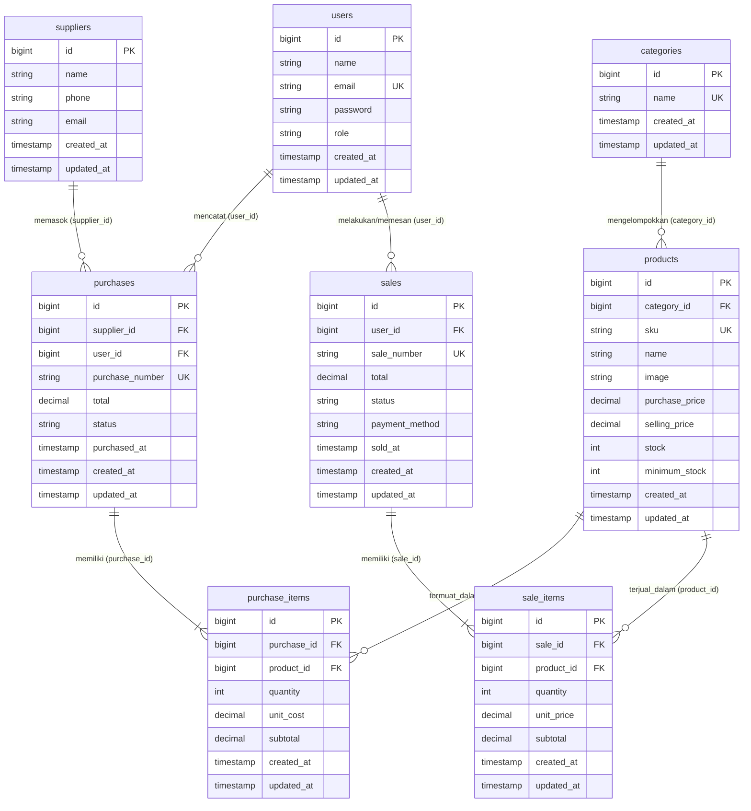

# 🏃‍♂️ RunnersVault - Inventory & Sales Management System

**RunnersVault** adalah aplikasi bisnis terintegrasi berbasis **Laravel 13 (`^13.17`)**, **MySQL**, **Eloquent ORM**, dan **Bootstrap 5** untuk mengelola master data perlengkapan lari, pemasok (*suppliers*), pembelian stok (*stock-in*), serta transaksi penjualan (*stock-out* / POS dan Customer Catalog) secara konsisten, aman, dan atomik.

Proyek ini disusun untuk memenuhi **Ujian Tengah Semester (UTS) Mata Kuliah Pemrograman Web 2**.

---

## 1. Requirements (Spesifikasi Lingkungan)

Sesuai dependensi pada `composer.json` dan arsitektur aplikasi:
* **PHP**: `>= 8.3`
* **Composer**: `>= 2.x`
* **Framework**: **Laravel 13** (`^13.17`)
* **Database**: **MySQL** `>= 8.0` atau **MariaDB** `>= 10.4` (SQLite in-memory otomatis digunakan untuk automated testing)
* **PHP Extensions**: `pdo_mysql`, `mbstring`, `openssl`, `tokenizer`, `xml`, `ctype`, `json`, `fileinfo`
* **Frontend**: Bootstrap 5 (CDN) & Bootstrap Icons (tanpa perlu Node.js/NPM build step)

---

## 2. Installation & Migration

Ikuti urutan langkah instalasi berikut secara berurutan untuk menjalankan proyek di komputer lokal:

```bash
# 1. Unduh dan install dependensi PHP
composer install

# 2. Salin template file konfigurasi environment
cp .env.example .env

# 3. Generate Application Encryption Key
php artisan key:generate

# 4. Sesuaikan konfigurasi database di file .env:
# Pastikan database 'runnersvault' sudah dibuat di MySQL Anda.
# DB_CONNECTION=mysql
# DB_HOST=127.0.0.1
# DB_PORT=3306
# DB_DATABASE=runnersvault
# DB_USERNAME=root
# DB_PASSWORD=

# 5. Jalankan migrasi tabel beserta data awal (seeder)
php artisan migrate --seed

# 6. Buat symbolic link untuk public storage (gambar produk)
php artisan storage:link

# 7. Jalankan local development server
php artisan serve
```

Aplikasi dapat langsung diakses melalui browser pada alamat: **`http://localhost:8000`**

---

## 3. Demo Accounts (Akun Pengujian)

Database Seeder telah menyiapkan 3 level akun pengguna untuk mempermudah pengujian dosen:

| Role | Email | Password | Hak Akses & Tanggung Jawab Utama |
| :--- | :--- | :--- | :--- |
| **Admin / Owner** | `admin@runnersvault.com` | `password` | Full CRUD Kategori, Produk, Supplier; Manajemen Pengguna & Perubahan Role; Pembatalan Transaksi (*Void*) |
| **Staff Kasir** | `staff@runnersvault.com` | `password` | Melihat Katalog & Detail Produk; Mencatat Pembelian (*Stock-In*) & Penjualan Kasir (*Stock-Out*); Melihat Riwayat |
| **Customer (Pelanggan)** | `customer@runnersvault.com` | `password` | Registrasi Mandiri; Melihat Katalog Produk; Melakukan Checkout Pesanan Pribadi; Melihat Riwayat & Nota Pesanan |

---

## 4. Entity Relationship Diagram (ERD) & Penjelasan Relasi

### A. Diagram Visual Mermaid ERD
Diagram relasi 8 tabel lengkap beserta tipe data, Primary Key (PK), Foreign Key (FK), Unique Constraint (UK), dan kardinalitas relasi:



### B. Diagram Relasi ASCII
```text
[users] 1 ─────────── * [sales] 1 ─────────── * [sale_items] * ────────── 1 [products]
   │                                                                           │
   1                                                                           *
   └──────────────── * [purchases] 1 ──────── * [purchase_items] * ───────────┘
                            *                                                  *
                            │                                                  │
                            1                                                  1
                       [suppliers]                                        [categories]
```

### C. Penjelasan Kardinalitas & Aturan Integritas Referential
1. **`categories` 1 — * `products`**:
   - Satu kategori dapat menaungi banyak produk (`hasMany`).
   - `category_id` pada tabel `products` dilindungi dengan `restrictOnDelete()` sehingga kategori yang masih digunakan oleh produk aktif tidak dapat dihapus sembarangan.
   - Kolom `categories.name` memiliki *unique constraint* di level basis data dan divalidasi unik di form.
2. **`suppliers` 1 — * `purchases`**:
   - Satu supplier dapat memasok banyak nota pembelian (`hasMany`). Dilindungi dengan `restrictOnDelete()`.
3. **`purchases` 1 — * `purchase_items`**:
   - Transaksi pembelian menyimpan rincian barang masuk di `purchase_items`. Jika nota pembelian dihapus/dibatalkan, item transaksi terikat secara `cascadeOnDelete()`.
4. **`products` 1 — * `purchase_items` & `sale_items`**:
   - Produk yang sudah memiliki riwayat transaksi dilindungi dari penghapusan (*Delete Protection* / `restrictOnDelete()`).
5. **`sales` 1 — * `sale_items`**:
   - Setiap transaksi penjualan menyimpan item yang dibeli beserta riwayat harga satuan riil saat transaksi berlangsung (`unit_price`).
6. **`users` 1 — * `sales` & `purchases`**:
   - Mengidentifikasi petugas kasir internal atau akun *customer* yang membuat pesanan.

---

## 5. Fitur Utama & Kepatuhan Aturan Bisnis

1. **Role-Based Access Control (RBAC) di Sisi Server**:
   - Proteksi multi-level menggunakan middleware `auth` dan `role:admin,staff` serta `role:customer`.
   - Rute administrasi sensitif (kategori, supplier, tambah/hapus produk, ubah role user) tidak dapat ditembus via manipulasi URL (`403 Forbidden`).
2. **Kunci Perubahan Stok Manual (Strict Inventory Rules)**:
   - Nilai stok **dikunci** (*read-only* / diabaikan) pada operasi update produk.
   - Stok hanya dapat bertambah secara otomatis melalui transaksi **Purchases (Stock-In)** dan berkurang melalui **Sales (Stock-Out)**.
3. **Manajemen Transaksi Atomik (ACID Compliant)**:
   - Seluruh mutasi stok dan pembuatan faktur dibungkus dalam `DB::transaction`.
   - Menggunakan row-level locking `lockForUpdate()` pada model `Product` untuk mencegah kondisi *race-condition* saat checkout bersamaan.
   - Jika stok tidak mencukupi atau terjadi kegagalan pada salah satu baris, transaksi otomatis dibatalkan (*rollback*) secara utuh tanpa meninggalkan inkonsistensi data.
4. **Pembatalan Transaksi (*Void Transaction*)**:
   - Hak istimewa Admin untuk membatalkan transaksi yang keliru. Sistem secara otomatis mengembalikan stok ke kondisi semula.
5. **Keamanan & Error Handling**:
   - Seluruh form dilindungi token CSRF (`@csrf`).
   - Logout hanya dapat dilakukan melalui metode `POST /logout` berproteksi CSRF.
   - Blok penanganan kesalahan tak terduga menggunakan `report($e)` ke log server tanpa membocorkan pesan sensitif ke layar pengguna.

---

## 6. Automated Testing (17 Feature Test Cases)

Seluruh fungsionalitas inti telah divalidasi menggunakan automated test suite bawaan Laravel/PHPUnit.

### Cara Menjalankan Test
Cukup jalankan perintah berikut pada terminal:

```bash
php artisan test
```

### Tabel Rincian 17 Test Case
| No | File Test | Method / Skenario Test | Aspek yang Diuji | Status |
| :-: | :--- | :--- | :--- | :-: |
| **1** | `ExampleTest` | `test_the_application_returns_a_successful_response` | Menguji pengalihan otomatis route root (`/`) ke halaman login (`/login`) untuk tamu yang belum terautentikasi | **PASS** |
| **2** | `InventorySystemTest` | `test_guest_cannot_access_dashboard_and_wrong_password_rejected` | Tamu dicegah mengakses dashboard internal dan ditolak saat memasukkan kredensial login yang salah | **PASS** |
| **3** | `InventorySystemTest` | `test_duplicate_sku_and_negative_price_are_rejected` | Form produk menolak SKU kembar (*duplicate*) serta harga beli/jual bernilai negatif | **PASS** |
| **4** | `InventorySystemTest` | `test_purchase_transaction_increases_product_stock` | Transaksi Pembelian (*Stock-In*) berhasil menambah stok produk secara otomatis dan presisi | **PASS** |
| **5** | `InventorySystemTest` | `test_sale_transaction_decreases_product_stock` | Transaksi Penjualan kasir (*Stock-Out*) berhasil mengurangi stok produk secara otomatis | **PASS** |
| **6** | `InventorySystemTest` | `test_sale_with_insufficient_stock_is_rejected_without_changing_data` | Transaksi penjualan ditolak jika jumlah pembelian melebihi stok yang ada, tanpa merubah data | **PASS** |
| **7** | `InventorySystemTest` | `test_transaction_rolls_back_all_items_if_one_item_fails` | Prinsip Atomicity (ACID): jika 1 item gagal stok, seluruh transaksi di-rollback secara konsisten | **PASS** |
| **8** | `InventorySystemTest` | `test_staff_cannot_access_admin_routes` | Otorisasi role: Staff kasir ditolak (403 Forbidden) saat mencoba mengakses rute CRUD Admin | **PASS** |
| **9** | `InventorySystemTest` | `test_product_search_and_category_filter_work_correctly` | Fitur filter produk berdasarkan kategori dan pencarian kata kunci SKU/nama berfungsi akurat | **PASS** |
| **10** | `InventorySystemTest` | `test_customer_can_order_products_and_stock_decreases_automatically` | Pelanggan (*Customer*) dapat memesan produk melalui katalog publik dan stok langsung terpotong | **PASS** |
| **11** | `InventorySystemTest` | `test_customer_cannot_access_dashboard_or_internal_routes` | Otorisasi isolasi: Pelanggan ditolak dengan respon 403 jika membuka dashboard atau rute kasir internal | **PASS** |
| **12** | `InventorySystemTest` | `test_guest_can_register_as_customer_and_redirect_to_catalog` | Pengunjung umum dapat mendaftar mandiri, mendapatkan role customer, dan diarahkan ke katalog | **PASS** |
| **13** | `InventorySystemTest` | `test_customer_cannot_view_other_customers_order` | Proteksi privasi data: Pelanggan dicegah (403) mengintip nota pesanan milik akun pelanggan lain | **PASS** |
| **14** | `InventorySystemTest` | `test_product_image_upload_and_accessor_work_correctly` | Upload file gambar tersimpan di disk public dan accessor `image_url` menghasilkan tautan yang benar | **PASS** |
| **15** | `InventorySystemTest` | `test_role_based_login_redirect_and_logout` | Pengalihan dinamis setelah login sesuai role (Admin ke Dashboard, Customer ke Katalog) & proteksi logout `POST` | **PASS** |
| **16** | `InventorySystemTest` | `test_updating_product_ignores_manual_stock_changes` | Menguji bahwa perubahan stok manual pada edit produk diabaikan (stok hanya berubah melalui transaksi) | **PASS** |
| **17** | `InventorySystemTest` | `test_sale_saves_selected_payment_method` | Menguji bahwa metode pembayaran yang dipilih (Cash, QRIS, Transfer, Card) tersimpan akurat di tabel penjualan | **PASS** |

---

## 7. Catatan Tambahan Pengujian Dosen
* **Database Reset**: Jika ingin mengembalikan data ke kondisi awal seeder sewaktu-waktu:
  ```bash
  php artisan migrate:fresh --seed
  ```
